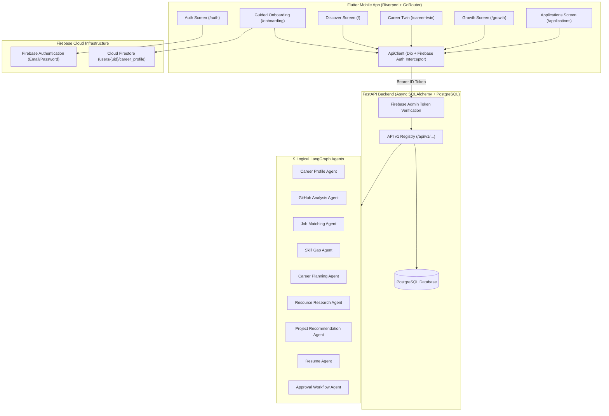

# Kuru Career Twin — Frontend + Backend End-to-End Integration Mapping

## 1. Architecture Overview

---

## 2. Screen-to-Endpoint-to-Agent Mapping

| Screen / Feature | Frontend Path | Backend Endpoint | HTTP Method | Governing Agent / Service | Purpose |
| :--- | :--- | :--- | :--- | :--- | :--- |
| **Authentication** | `/auth` | Firebase Auth SDK | N/A | `AuthService` | User signup, sign-in, session restore, token refresh |
| **Guided Onboarding (Drafts)** | `/onboarding` | `users/{uid}/career_profile` | Firestore Set | `FirestoreService` | Autosaves step-by-step onboarding wizard progress |
| **Guided Onboarding (Sync)** | `/onboarding` | `/api/v1/profiles/sync` | `POST` | `CareerProfileAgent` / `profiles.py` | Idempotently synchronizes completed onboarding data to PostgreSQL `StudentProfile` |
| **Discover (Job Feed)** | `/` | `/api/v1/jobs` | `GET` | `JobMatchingAgent` | Fetches active tech jobs, match score calculation, skill breakdown |
| **Discover (Job Detail)** | `/jobs/:id` | `/api/v1/jobs/{id}` | `GET` | `JobMatchingAgent` | Job description, requirements, AI match analysis, and skill fit |
| **Discover (Save Job)** | `/jobs/:id` | `/api/v1/jobs/{id}/save` | `POST` | `jobs.py` | Toggles bookmark / saved job status |
| **Career Twin & SkillProof** | `/` (Tab 1) | `/api/v1/career-twin` | `GET` | `GitHubAnalysisAgent` & `CareerIntelligenceService` | Readiness score, demonstrated skills, AST evidence, and connected repos |
| **Career Twin (Refresh)** | `/` (Tab 1) | `/api/v1/career-twin/assess` | `POST` | `PracticalAssessmentEngine` | Forces real-time reassessment based on latest code commits and challenges |
| **GitHub Connect** | `/` (Tab 1) | `/api/v1/github/connect` | `POST` | `GitHubAnalysisAgent` | Links user GitHub handle for syntax tree repository analysis |
| **Growth (Daily Goals)** | `/` (Tab 2) | `/api/v1/growth/goals` | `GET` | `CareerPlanningAgent` / `Reminder` | Daily study goals prioritized by skill gaps |
| **Growth (Toggle Goal)** | `/` (Tab 2) | `/api/v1/growth/goals/{id}` | `PATCH` | `reminders.py` | Marks daily learning goal completed |
| **Growth (Roadmap)** | `/` (Tab 2) | `/api/v1/growth/roadmap` | `GET` | `CareerPlanningAgent` | Multi-week learning roadmap with milestone modules |
| **Growth (Resources)** | `/` (Tab 2) | `/api/v1/growth/resources` | `GET` | `ResourceResearchAgent` | Authentic, verified documentation and tutorial links (whitelisted URLs only) |
| **Growth (Projects)** | `/` (Tab 2) | `/api/v1/growth/projects` | `GET` | `ProjectRecommendationAgent` | Portfolio-grade project recommendations targeting candidate skill gaps |
| **Applications (Tracker)** | `/` (Tab 3) | `/api/v1/applications` | `GET` | `ApplicationService` | Active tracked applications, metric counts (applied, in review, interview, offer) |
| **Applications (Prepare)** | `/jobs/:id` | `/api/v1/applications/prepare` | `POST` | `ApprovalWorkflowAgent` & `ResumeAgent` | Synthesizes tailored application packet and stages approval request |
| **Resume (Tailor for Role)**| `/` (Tab 3) | `/api/v1/resumes/tailor` | `POST` | `ResumeAgent` | Generates ATS-friendly resume tailored against target job/company without hallucination |
| **Resume (PDF Export)** | `/resumes` | `/api/v1/resumes/{id}/pdf` | `GET` | `PurePythonPdfExporter` | Exports clean, ATS-compliant PDF resume |
| **Alerts & Notifications** | Modal | `/api/v1/notifications` | `GET`, `PATCH` | `NotificationService` | In-app alerts for application updates, deadlines, and approvals |

---

## 3. Data Ownership & Synchronization Model

1. **Cloud Firestore Ownership**:
   - `users/{uid}/career_profile`: Guided onboarding profile, completion status (`is_onboarding_completed: bool`), draft steps, mobile notes, and UI preferences.
   - Real-time updates and offline mobile caching.

2. **PostgreSQL Ownership**:
   - Core relational business records: `StudentProfile`, `JobPosting`, `StudentSkill`, `PracticalAssessment`, `Resume`, `JobApplication`, `Notification`, `Reminder`, and `AgentWorkflowRun`.
   - Strict row-level scoping: every query filters `WHERE firebase_uid = current_user.uid`.

3. **Idempotent Synchronization**:
   - When the user finishes the 4-step onboarding wizard in the Flutter app, `OnboardingScreen` calls `POST /api/v1/profiles/sync`.
   - The backend checks for an existing `StudentProfile` for the verified `current_user.uid`. If present, it updates attributes; if missing, it inserts a new record. Subsequent logins or profile edits never generate 409 Conflict errors.

---

## 4. One-Time Guided Onboarding & Returning User Flow

1. **First-Time User (New Signup)**:
   - User registers via Firebase Auth (`AuthService.signUpWithEmail`).
   - App checks `FirestoreService.isOnboardingCompleted(uid)`. Returns `false`.
   - App routes to `/onboarding`.
   - User progresses through 4 steps:
     - **Step 1**: Candidate Details (Full Name, Degree, College/University, Graduation Year)
     - **Step 2**: Target Role & Preferences (Target Job Title, Locations, Remote/Hybrid, Experience Level)
     - **Step 3**: Current Skills & GitHub (Skills list, GitHub username for SkillProof)
     - **Step 4**: Learning Preferences & Goals (Study hours/week, learning style, bio)
   - Step progress is autosaved to Firestore on each transition.
   - On completion, `is_onboarding_completed` is set to `true`, profile is synced to PostgreSQL, and user is redirected to `/` (Dashboard).

2. **Returning User (Subsequent Logins)**:
   - User signs in via email/password or restored session.
   - `FirestoreService.isOnboardingCompleted(uid)` returns `true`.
   - App bypasses onboarding entirely and presents the Discover dashboard (`/`).

---

## 5. Security, Anti-Hallucination, and Human-in-the-Loop Guarantees

1. **Authentication Integrity**:
   - Client sends fresh Firebase ID tokens dynamically retrieved from `FirebaseAuth.instance.currentUser?.getIdToken()`.
   - Backend `get_current_user` validates token cryptographically with Firebase Admin SDK. Client-supplied UIDs in request bodies are ignored.

2. **Zero Hallucination Guarantee**:
   - All resume bullets, project evidence tags, and skill confidence scores are verified against actual GitHub AST code syntax trees and practical assessment challenge executions.
   - Resource Research Agent queries strictly from the official documentation whitelist with HTTPS checks.

3. **Human Approval Gate**:
   - Applications staged via `POST /api/v1/applications/prepare` generate an `AgentApprovalRequest`.
   - External application submissions remain strictly blocked until the candidate explicitly provides cryptographic approval through the UI.
