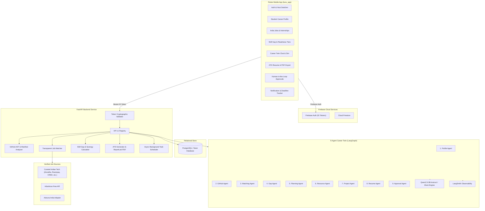

# Kuru — AI-Powered Career Twin & Student Job Discovery Platform

[](https://flutter.dev)
[](https://fastapi.tiangolo.com)
[](https://www.python.org)
[](https://www.postgresql.org)
[](https://firebase.google.com)
[](https://vercel.com/new/clone?repository-url=https%3A%2F%2Fgithub.com%2Fstylegunhawk65-jpg%2Fkuru_backend)
[](https://github.com/stylegunhawk65-jpg/kuru_backend/releases/latest/download/app-release.apk)

**Kuru** is an end-to-end, AI-powered Career Twin ecosystem designed specifically for engineering students and early-career job seekers in the Indian technology ecosystem. 

Unlike traditional job boards or generic AI wrappers, Kuru analyzes a student's actual GitHub source code to extract verified, evidence-backed engineering skills. It pairs this portfolio with live curated Indian tech postings, evaluates deterministic skill gaps, runs interactive what-if career simulations through a 9-agent AI system, generates tailored ATS-friendly resumes with verifiable citations, and manages application deadlines with proactive notifications.

---

## 📱 Mobile App Download & Live Deployment

| Component | Platform | Access Link |
| :--- | :--- | :--- |
| **Android Mobile App** | Direct APK | [📲 Download Latest Android APK](https://github.com/stylegunhawk65-jpg/kuru_backend/releases/latest/download/app-release.apk) |
| **GitHub Releases** | All Releases | [📦 GitHub Releases & Binaries](https://github.com/stylegunhawk65-jpg/kuru_backend/releases) |
| **Serverless Backend** | Vercel | [⚡ 1-Click Deploy on Vercel](https://vercel.com/new/clone?repository-url=https%3A%2F%2Fgithub.com%2Fstylegunhawk65-jpg%2Fkuru_backend) |
| **Containerized Backend** | Render | [🚀 Deploy via Render Blueprint](https://render.com) using [`render.yaml`](render.yaml) |
| **Interactive API Docs** | Swagger / OpenAPI | `http://localhost:8000/docs` or your deployed URL `/docs` |

---

## 🏛️ System Architecture



---

## ✨ Complete Feature Breakdown

### 1. 📱 Flutter Mobile Experience (`kuru_app`)
- **Modern Material 3 Interface**: Intuitive design using high-contrast branding (Indigo `#4F46E5`, Teal `#0D9488`, Emerald `#10B981`).
- **Dynamic Host Switcher**: Connect effortlessly to local development (`10.0.2.2:8000`, `127.0.0.1:8000`), local Wi-Fi, Vercel, or Render directly from the login screen without rebuilding the app.
- **Offline / Guest Mode**: Try demo student profiles and mock job matches instantly without needing an active Firebase account.
- **Single-Screen Career Hub**: Bottom navigation bar integrating Profile, Discovery, Intelligence, Career Twin, Resume, and Alerts.

### 2. 🔍 GitHub Static Code Analysis & Skill Graph
- **Zero Untrusted Code Execution**: Inspects repositories safely using AST module extraction and manifest parsing (`pyproject.toml`, `requirements.txt`, `package.json`, `pom.xml`, `go.mod`, `Cargo.toml`, Dockerfiles).
- **Evidence-Backed Skills**: Extracts languages, frameworks, libraries, and tools with 0.0–1.0 confidence ratings and verifiable file/line citations.
- **Skill Knowledge Graph**: Generates relational dependency links (e.g., `FastAPI` $\rightarrow$ `requires_language` $\rightarrow$ `Python`, `SQLAlchemy` $\rightarrow$ `integrates_with` $\rightarrow$ `PostgreSQL`).
- **Cryptographic Security**: Access tokens are AES/Fernet-encrypted at rest and never returned in API responses or logs.

### 3. 💼 Live Indian Tech & Internship Discovery
- **Curated Indian Tech Opportunities**: Pre-seeded with verified roles from top Indian technology companies and startups (Zerodha, Razorpay, Swiggy, CRED, Postman, Hasura, Juspay, Flipkart, TCS, Infosys) across Bengaluru, Hyderabad, Pune, Mumbai, Delhi-NCR, and Remote.
- **Deterministic 100-Point Match Score**:
  - **Evidence-Backed Skills (50%)**: Measured against actual code portfolio.
  - **Target Role Alignment (25%)**: Title overlap.
  - **Location Alignment (15%)**: City and remote preference matching.
  - **Career Interest Alignment (10%)**: Topic alignment.
- **Total Transparency**: Every match score shows exact arithmetic `match_reasons` with matched and missing skills.
- **Bookmarking & Tracking**: Save listings and monitor status in your personal workspace.

### 4. 🧠 Explainable Skill-Gap Analysis & Readiness Tiers
- **Readiness Tiers**: Automatically classifies student portfolio readiness into:
  - 🟢 **Ready** ($\ge 80\%$)
  - 🔵 **High** ($65 - 79\%$)
  - 🟡 **Moderate** ($45 - 64\%$)
  - 🟠 **Developing** ($25 - 44\%$)
  - ⚪ **Early** ($< 25\%$)
- **Prioritized Skill Gap Formula**:
  $$\text{Priority Score} = \text{Market Demand}\,(50\%) + \text{Graph Proximity}\,(30\%) + \text{Career Interest}\,(20\%)$$
- **Synergy Discovery**: Calculates 1-hop learning synergies (e.g., already knowing Python reduces the effort required to master FastAPI).
- **What-If Simulations**: Interactive tool allowing students to simulate: *"What if I learn Docker and Redis?"* — projecting the exact fit score boost and newly unlocked job postings.

### 5. 🤖 9-Agent Career Twin & Interactive Workflow
Orchestrated using **LangGraph** with human-in-the-loop safeguards:
1. **Career Profile Agent**: Consolidates background, skills, and goals.
2. **GitHub Analysis Agent**: Extracts concrete evidence from code repositories.
3. **Job Matching Agent**: Discovers and scores live market opportunities.
4. **Skill Gap Agent**: Ranks deficiencies and computes learning runways.
5. **Career Planning Agent**: Builds multi-week progressive milestone roadmaps.
6. **Resource Research Agent**: Curates free, reputable Indian and global courses/docs.
7. **Project Recommendation Agent**: Proposes portfolio projects targeting specific gap closure.
8. **Resume Agent**: Drafts tailored resumes citing specific GitHub code evidence.
9. **Approval Workflow Agent**: Pauses actions for human student consent before committing.

### 6. 📄 Dynamic ATS Resume Builder & Pure-Python PDF Export
- **Automated Customization**: Tailors resume summaries, project bullet points, and skills to target job descriptions.
- **Evidence Citations**: Generates verifiable links back to the student's actual GitHub repositories.
- **Pure-Python PDF Generation**: Compiles publication-quality, ATS-parseable PDF resumes on-the-fly using ReportLab without external heavy system dependencies.

### 7. 🔔 Lifecycle Tracking & Notification Center
- **Application Status Tracking**: Manage applications through stages (`Saved`, `Applied`, `Interviewing`, `Offered`, `Rejected`).
- **Proactive Reminders**: Configurable reminders for application deadlines, interviews, and roadmap study milestones.
- **Background Scheduler**: Lightweight async in-memory scheduler ensuring instant responsiveness without heavyweight external brokers.

---

## 📂 Project Repository Structure

```text
kuru_backend/
├── .github/workflows/
│   └── build-and-release-apk.yml  # Automated GitHub Actions workflow for Flutter APK
├── api/
│   └── index.py                   # Vercel Serverless Function entrypoint
├── app/                           # FastAPI Core Backend Service
│   ├── api/v1/                    # RESTful Endpoints
│   │   ├── endpoints/             # profiles, github, jobs, growth, career_twin, resumes
│   │   └── router.py              # Central API v1 router
│   ├── core/                      # Config, security, exceptions, and logging
│   ├── db/                        # Async SQLAlchemy engine, session, and base model
│   ├── models/                    # PostgreSQL models (Profile, Job, Skill, Resume, etc.)
│   ├── schemas/                   # Pydantic v2 schemas for requests & responses
│   ├── services/                  # Business logic (Analyzer, Matcher, AI Agents, PDF)
│   └── main.py                    # FastAPI application initialization & lifespan
├── kuru_app/                      # Flutter Android & Multiplatform Client
│   ├── android/                   # Native Android wrapper (Kotlin 2.4, Gradle 8.14)
│   ├── lib/                       # Dart source code
│   │   ├── core/                  # Theme (Material 3), API Config, network clients
│   │   ├── models/                # Client-side data models
│   │   ├── screens/               # UI Screens (Login, Jobs, Career Twin, Resume, Gaps)
│   │   └── main.dart              # Flutter application root
│   └── pubspec.yaml               # Flutter package configuration
├── tests/                         # Comprehensive pytest test suite (196 passing tests)
├── render.yaml                    # Render Blueprint Infrastructure-as-Code
├── vercel.json                    # Vercel Serverless deployment configuration
├── requirements.txt               # Backend Python dependencies
└── README.md                      # Comprehensive project documentation
```

---

## 🚀 Quick Start Guide

### Option A: Install and Run the Mobile App
1. Download the pre-built APK directly to your Android device:
   👉 **[Download Latest Android APK](https://github.com/stylegunhawk65-jpg/kuru_backend/releases/latest/download/app-release.apk)**
2. Tap the downloaded file to install (allow "Install from Unknown Sources" if prompted).
3. On the login screen:
   - Use **Demo / Guest Mode** to explore pre-seeded data immediately.
   - Or enter your custom backend URL (local or cloud) using the host configuration field.

---

### Option B: Local Backend Development

#### 1. Prerequisites
- Python 3.12+
- PostgreSQL (or use an in-memory SQLite URL for instant testing)

#### 2. Setup Virtual Environment
```bash
# Clone the repository
git clone https://github.com/stylegunhawk65-jpg/kuru_backend.git
cd kuru_backend

# Create virtual environment
python -m venv .venv

# Activate on Windows:
.venv\Scripts\activate
# Activate on Linux / macOS:
source .venv/bin/activate

# Install dependencies
pip install -r requirements.txt
```

#### 3. Configure Environment Variables
Copy `.env.example` to `.env`:
```bash
cp .env.example .env
```
Default settings work out-of-the-box for local testing using `LLM_PROVIDER="mock"`.

#### 4. Run Database Migrations & Start Server
```bash
# Start FastAPI with live reload
uvicorn app.main:app --reload --host 0.0.0.0 --port 8000
```
Open **`http://localhost:8000/docs`** to explore the interactive OpenAPI/Swagger documentation.

#### 5. Run the Test Suite
```bash
pytest -q
```
*Current test suite: **196 passed**, 100% passing rate.*

---

### Option C: Local Flutter Client Development

#### 1. Prerequisites
- Flutter SDK 3.24+ (Recommended: Flutter 3.41+)
- Android Studio / Android SDK (API 34+)

#### 2. Run the App
```bash
cd kuru_app

# Install dependencies
flutter pub get

# Launch on connected Android device or emulator
flutter run
```

#### 3. Build Production Release APK
```bash
cd kuru_app
flutter build apk --release
# Generated output: kuru_app/build/app/outputs/apk/release/app-release.apk
```

---

## ☁️ Cloud Deployment

### 1. Deploy Backend on Vercel (Free Serverless)
Vercel hosts the FastAPI backend serverlessly with zero server management:
1. Click the one-click deploy button:
   [](https://vercel.com/new/clone?repository-url=https%3A%2F%2Fgithub.com%2Fstylegunhawk65-jpg%2Fkuru_backend)
2. Add your environment variables (`FIREBASE_PROJECT_ID`, `ENVIRONMENT=production`, and `DATABASE_URL` from free [Neon](https://neon.tech) or [Supabase](https://supabase.com)).
3. Hit **Deploy** — your API will be live at `https://<your-project>.vercel.app`.

### 2. Deploy Backend on Render (Blueprint)
Your repository includes [`render.yaml`](render.yaml) for 1-click infrastructure provisioning:
1. Go to [Render Dashboard](https://dashboard.render.com/) > **New +** > **Blueprint**.
2. Connect `stylegunhawk65-jpg/kuru_backend`.
3. Render will provision both the PostgreSQL Database (`kuru-db`) and the FastAPI Web Service (`kuru-backend`) automatically.

---

## 🔒 Security, Privacy & Compliance

- **No Code Execution**: Student source code is parsed exclusively via abstract syntax trees (AST) and regex manifest inspection. Code is **never executed** on our servers.
- **Token Protection**: GitHub OAuth and access tokens are encrypted with AES-256 (Fernet) at rest.
- **Scraping Compliance**: Complies strictly with anti-scraping policies; job aggregation relies solely on open APIs and official partner adapters without bypassing bot firewalls.
- **Isolated User Context**: All API requests require a cryptographically verified Firebase ID token (`Bearer <token>`). Multi-tenant data is strictly segmented by verified user ID.

---

## 📄 License

This project is licensed under the MIT License — see the [LICENSE](LICENSE) file for details.
